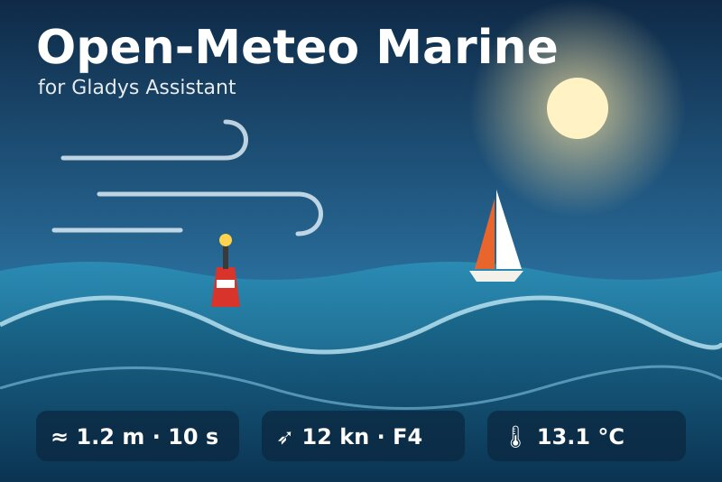
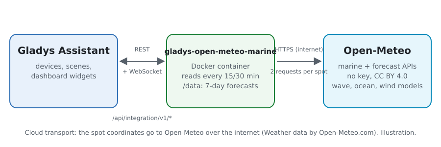
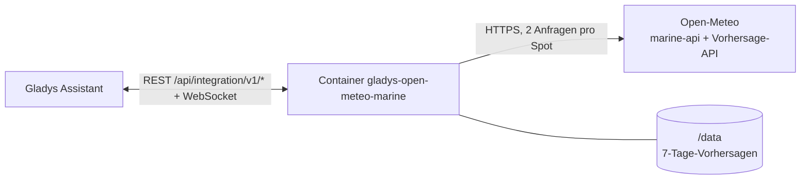
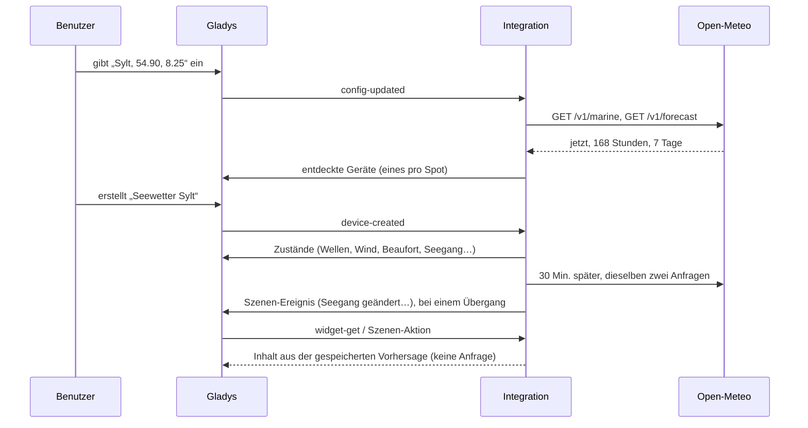
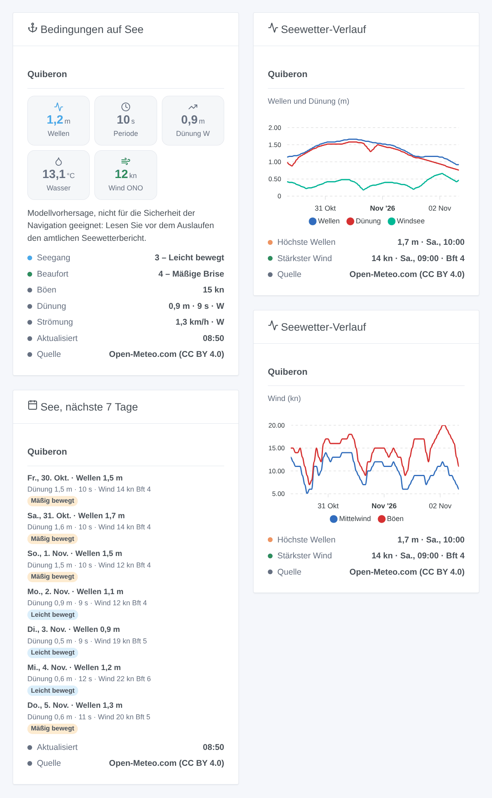

# Gladys Open-Meteo Marine

[English](README.md) · [Français](README.fr.md) · **Deutsch** · [Español](README.es.md)

[](LICENSE)
[](https://github.com/William-De71/gladys-open-meteo-marine/releases)
[](https://github.com/William-De71/gladys-open-meteo-marine/actions/workflows/release.yml)
[](https://gladysassistant.com)



Externe Integration für [Gladys Assistant](https://gladysassistant.com) mit dem **Seewetter von [Open-Meteo](https://open-meteo.com)** für bis zu fünf Spots Ihrer Wahl, weltweit: Wellen, Dünung, Windsee, Wassertemperatur, Strömung, Meeresspiegel, Wind, Beaufort-Stärke und Seegang (Douglas), jetzt und für sieben Tage. Ohne Konto, ohne Schlüssel.

Benutzerdokumentation: [English](docs/en.md) · [Français](docs/fr.md) · [Deutsch](docs/de.md) · [Español](docs/es.md).

> Community-Integration, nicht mit Open-Meteo verbunden. [Wetterdaten von Open-Meteo.com](https://open-meteo.com/), unter [CC BY 4.0](https://creativecommons.org/licenses/by/4.0/). **Es sind Modellvorhersagen, nicht für die Sicherheit der Navigation geeignet**: Lesen Sie vor dem Auslaufen den amtlichen Seewetterbericht (DWD).

## Funktionen

- **Ein Gerät pro Spot**, bis zu fünf, jeweils als Name und „Breite, Länge“ auf dem Meer eingegeben.
- **15 Funktionen pro Spot**: signifikante Wellenhöhe, Periode und Richtung; Höhe, Periode und Richtung der Dünung; Windseehöhe; Wassertemperatur; Strömung; Meeresspiegel (mit Gezeiten); Mittelwind, Böen und Windrichtung; **Beaufort-Stärke** und **Seegang (Douglas)**, von der Integration berechnet.
- **3 Szenen-Auslöser**, **1 Szenen-Aktion** und **3 Dashboard-Widgets** (siehe unten).
- Wind in **Knoten**, km/h oder m/s in den Widgets und Szenentexten.
- Abfrage alle 15 oder 30 Minuten, zwei Anfragen pro Spot; die Vorhersagen bleiben über Neustarts erhalten.
- Ein Punkt an Land (ohne Meeresdaten) wird mit einer klaren Meldung abgelehnt.
- Vier Sprachen überall: Englisch, Französisch, Deutsch, Spanisch.

## Funktionsweise





Für jeden Spot fragt die Integration die [Marine Weather API](https://open-meteo.com/en/docs/marine-weather-api) (Wellen, Dünung, Oberflächentemperatur, Strömung, Meeresspiegel) und die [Forecast API](https://open-meteo.com/en/docs) (Wind in 10 m: Die Marine-API liefert keinen). Jede Antwort enthält die aktuellen Bedingungen (Modelldaten im 15-Minuten-Takt), 168 Stunden und 7 Tage. Open-Meteo nimmt die nächstgelegene Meereszelle der Wellenmodelle (5 bis 25 km): Ein am Strand eingegebener Punkt erhält trotzdem Wellen; ein Punkt im Binnenland erhält nichts und wird abgelehnt. Der Schlüssel des Geräts stammt aus den auf zwei Dezimalstellen gerundeten Koordinaten (etwa 1 km): Ein umbenannter Spot behält sein Gerät.



### Transport

Nur Cloud (`"transports": ["cloud"]`): Der Katalog zeigt das Cloud-Abzeichen. Die Koordinaten der Spots werden über das Internet an Open-Meteo gesendet; sonst nichts über Ihr Zuhause. Eine lokale Alternative gibt es nicht, daher auch keine Schaltfläche „Lokale Verbindung bevorzugen“.

## Geräte und Funktionen

| Funktion                             | Kategorie / Typ                | Einheit, Grenzen                 |
| ------------------------------------ | ------------------------------ | -------------------------------- |
| Höhe von Wellen, Dünung und Windsee  | `distance-sensor` / `decimal`  | m, 0 … 30                        |
| Periode von Wellen und Dünung        | `duration` / `decimal`         | s, 0 … 30                        |
| Richtung von Wellen, Dünung und Wind | `angle-sensor` / `integer`     | Grad, 0 … 360 (woher sie kommen) |
| Wassertemperatur                     | `temperature-sensor` / `probe` | °C, -5 … 40                      |
| Strömungsgeschwindigkeit             | `speed-sensor` / `decimal`     | km/h, 0 … 30                     |
| Meeresspiegel (über dem mittleren)   | `level-sensor` / `decimal`     | m, -10 … 10, mit Gezeiten        |
| Mittelwind, Böen                     | `speed-sensor` / `decimal`     | km/h, 0 … 400                    |
| Beaufort-Stärke                      | `speed-sensor` / `integer`     | 0 … 12, ohne Einheit             |
| Seegang (Douglas)                    | `level-sensor` / `decimal`     | 0 … 9, ohne Einheit              |

Die Geräte sind in km/h, weil Gladys keine Knoten-Einheit kennt; Widgets und Szenentexte folgen der **Windeinheit** der Konfiguration. Die Wassertemperatur nutzt den Typ `probe`, damit das Meer nie in die Temperatur eines Raums eingeht. Die Werte stammen aus der letzten Abfrage, solange sie weniger als eine Stunde alt ist, danach aus der stündlichen Vorhersage der aktuellen Stunde; ein Wert, den Open-Meteo nicht liefert (Strömung oder Meeresspiegel in manchen Meeren), wird nicht veröffentlicht.

Seegang (Douglas) aus der signifikanten Wellenhöhe: 0 spiegelglatt 0 m, 1 ruhig ≤ 0,1 m, 2 schwach bewegt ≤ 0,5 m, 3 leicht bewegt ≤ 1,25 m, 4 mäßig bewegt ≤ 2,5 m, 5 grob ≤ 4 m, 6 sehr grob ≤ 6 m, 7 hoch ≤ 9 m, 8 sehr hoch ≤ 14 m, 9 extrem schwer. Beaufort-Stärke aus dem Mittelwind in Knoten (WMO-Grenzen).

## Szenen-Auslöser, Aktionen und Widgets



**Szenen-Auslöser** (ein Ereignis pro Übergang; die erste Abfrage eines Spots dient als Referenz; ein Wert innerhalb von 5 % einer Grenze behält seine Stufe, Modellrauschen löst also nichts aus):

- **Seegang geändert**: Der Seegang (Douglas) eines Spots ändert sich. Filter: Spot, neuer Seegang. Variablen: Seegang und Name, vorheriger, steigend, Wellenhöhe, -periode und -richtung, Dünung, Zusammenfassung.
- **Windstärke geändert**: Die Beaufort-Stärke des Mittelwinds ändert sich. Filter: Spot, neue Stärke. Variablen: Stärke und Name, vorherige, steigend, Wind in km/h und Knoten, Böen, Richtung, Zusammenfassung.
- **Starkwind erwartet**: Die nächsten 24 Stunden erreichen Stärke 7 (steifer Wind) oder mehr, die Schwelle der Starkwindwarnungen, oder eine höhere Stärke als bereits gemeldet. Filter: Spot, höchste Stärke. Variablen: Stärke, Wind, Böen, Beginn, Stunden bis dahin, Zusammenfassung.

**Szenen-Aktion**: **Seewetter lesen** für einen Spot, jetzt oder bis zu 168 Stunden später: Wellen, Dünung, Windsee, Wasser, Wind (km/h und Knoten), Böen, Beaufort-Stärke, Seegang und eine fertige Zusammenfassung (19 Ausgaben). Keine Anfrage an Open-Meteo: Sie liest die gespeicherte Vorhersage.

**Widgets**: **Bedingungen auf See** (Kacheln für Wellen, Periode, Dünung, Wasser und Wind; Seegang, Beaufort, Böen, Dünung, Strömung; der Navigationshinweis), **Seewetter-Verlauf** (48 oder 72 Stunden Wellen, Dünung und Windsee, oder Wind und Böen) und **See, nächste 7 Tage** (höchste Wellen, Dünung und Periode, stärkster Wind, der Seegang als Abzeichen). Jedes nennt seine Quelle.

Beispiele:

- Wenn der **Seegang „grob“ oder mehr** am Hafen erreicht → `{{triggerEvent.data.summary}}` an den Skipper senden.
- Wenn **Starkwind erwartet** wird → benachrichtigen und die Gartenmöbel hereinholen.
- Jeden Samstag um 7:00 → **Seewetter lesen** in 3 Stunden und die Zusammenfassung senden, wenn die Dünung über 1 m und die Periode über 10 s liegt.

## Voraussetzungen

- Gladys Assistant **5.3.0** oder neuer (Katalog-Schlüsselwörter von Gladys 5.3, Widgets und Szenen externer Integrationen). Ältere Instanzen können die Integration nicht installieren.
- Internetzugang von Gladys aus.
- Eine nicht kommerzielle Nutzung: Die kostenlose API von Open-Meteo erlaubt weniger als 10.000 Aufrufe pro Tag; fünf Spots alle 15 Minuten bleiben weit darunter.

## Installation

- **Aus dem Store** von Gladys (Integrationen → Externe Integrationen), mit einem Klick, sobald indexiert.
- **Über die URL des Repositorys**: `https://github.com/William-De71/gladys-open-meteo-marine`.
- **Entwicklermodus**: das Image lokal bauen (`docker build -t gladys-open-meteo-marine .`) und aus Gladys installieren.

## Konfiguration

| Feld                      | Beschreibung                                                                       |
| ------------------------- | ---------------------------------------------------------------------------------- |
| Spot 1 … 5: Name          | Im Gerät und in den Widgets angezeigt. Optional (Standard: „Spot n“).              |
| Spot 1 … 5: Breite, Länge | Dezimalgrad, auf dem Meer, einige km vor der Küste: `54.90, 8.25`. Spot 1 Pflicht. |
| Abfrageintervall          | 15 oder 30 Minuten (Standard 30).                                                  |
| Windeinheit               | Knoten (Standard), km/h oder m/s, für Widgets und Szenentexte.                     |
| Sprache der Texte         | Gerätenamen und Szenen-Zusammenfassungen (automatisch: Ihr Dashboard).             |

Schaltflächen: **Jetzt lesen** (fragt auch einen als Landpunkt abgelehnten Spot erneut; nicht erneut innerhalb von fünf Minuten, wenn die Daten frisch sind) und **Diagnose** (schreibt den Zustand der Integration in den Tab Protokolle).

## Verwendung

1. Geben Sie einen bis fünf Spots ein (Rechtsklick auf das Meer in Google Maps oder OpenStreetMap für die Koordinaten) und speichern Sie.
2. Erstellen Sie im Tab **Entdecken** das Gerät „Seewetter …“ jedes Spots.
3. Fügen Sie die Widgets einem Dashboard hinzu und bauen Sie Szenen mit den Auslösern und der Aktion oben.

## Entwicklung

```bash
npm install
npm test                       # node --test, nie mit Netzwerk
npm run lint && npm run format:check
npx github:GladysAssistant/integration-store . --skip-image-check
scripts/build-cover.sh         # cover.jpg aus docs/assets/cover.svg
docs/illustrations/render.sh   # docs/assets/widgets.<lang>.png
node .github/scripts/release.mjs next
```

Lokal liest das SDK `GLADYS_HOST_API_URL`, `GLADYS_INTEGRATION_TOKEN` und `GLADYS_INTEGRATION_SELECTOR`. `DEBUG=gladys-integration-sdk` zeigt die SDK-Protokolle und prüft jeden Widget-Inhalt. Die Tests lesen echte, in `test/fixtures/` aufgezeichnete Antworten von Open-Meteo (vor Quiberon, vor Marseille und Lyon im Binnenland). Die Regeln des Projekts stehen in [CLAUDE.md](CLAUDE.md).

## Release-Prozess


Jeder Merge auf `main` startet die CI und berechnet dann die Version aus den [Conventional Commits](https://www.conventionalcommits.org/) seit dem letzten Tag: `feat` → Minor, `fix` / `perf` → Patch, `!` oder `BREAKING CHANGE` → Major (ein Minor unter 1.0.0). `docs`, `chore`, `ci`, `test`, `style`, `refactor` und `build` allein veröffentlichen nichts. Der Workflow erzeugt dann den Changelog-Abschnitt, pusht den Tag und baut das Multi-Architektur-Image. Erst danach erhält `main` den Release-Commit und das GitHub Release wird erstellt. Ein letzter Job prüft das öffentliche Image, den Store-Validator und das Topic.

- Der Titel des Pull Requests wird zum Squash-Commit und dann zur Changelog-Zeile: auf Englisch, für den Benutzer (`pr-title.yml` prüft ihn). `CHANGELOG.md` nie von Hand bearbeiten.
- 1.0.0 ist eine Entscheidung: Actions → Release → Run workflow mit `release-as: 1.0.0`. `dry-run` zeigt Version und Notizen, ohne zu veröffentlichen.
- **Geschützter Branch**: Das Release pusht seinen Commit mit `GITHUB_TOKEN` auf `main`. Bei einem Ruleset auf `main`, das strenger ist als „kein Löschen, kein Force-Push“, GitHub Actions zur Bypass-Liste hinzufügen (oder über eine GitHub App pushen). Sonst schlägt der Veröffentlichungs-Job mit Anweisungen fehl.
- Nach dem ersten Release das Paket auf `ghcr.io` öffentlich machen (Package settings → Change visibility), sonst kann Gladys es nicht laden.

## Fehlerbehebung

Siehe [docs/de.md](docs/de.md#fehlerbehebung). Melden Sie Probleme mit den Versionen von Gladys und der Integration, den Spots und den Zeilen der Schaltfläche **Diagnose**.

## Mitwirken

Issues und Pull Requests sind willkommen. Führen Sie vor einem Pull Request `npm run format:check && npm run lint && npm test` aus und lassen Sie alle External-IDs und gespeicherten Schlüssel unverändert (siehe [CLAUDE.md](CLAUDE.md)). Ändert sich eine Antwort von Open-Meteo, zeichnen Sie sie in `test/fixtures/` auf, bevor Sie den Leser korrigieren.

## Sicherheit

Siehe [SECURITY.md](SECURITY.md): Schwachstellen vertraulich melden. Die Integration hat kein Geheimnis zu hüten. Sie sendet nur die Koordinaten der Spots an Open-Meteo, mit einem User-Agent, der das Projekt nennt.

## Kommende Screenshots

Die Bilder oben sind Illustrationen, keine Screenshots. Echte Screenshots kommen nach `docs/assets/screenshots/` (PNG, 1280 × 800): `configuration.png`, `discovery.png`, `device.png`, `scene.png`.

## Lizenz

[Apache-Lizenz 2.0](LICENSE) — siehe auch [NOTICE](NOTICE). [Wetterdaten von Open-Meteo.com](https://open-meteo.com/), unter [CC BY 4.0](https://creativecommons.org/licenses/by/4.0/), aus den Modellen nationaler Wetterdienste; die Widgets nennen ihre Quelle. Dank an die Dokumentation und das SDK von Gladys und an Open-Meteo für seine kostenlose API.
