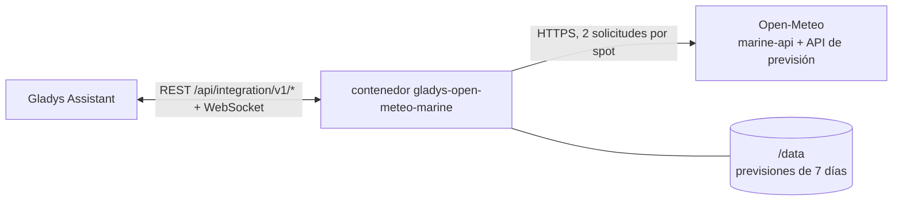
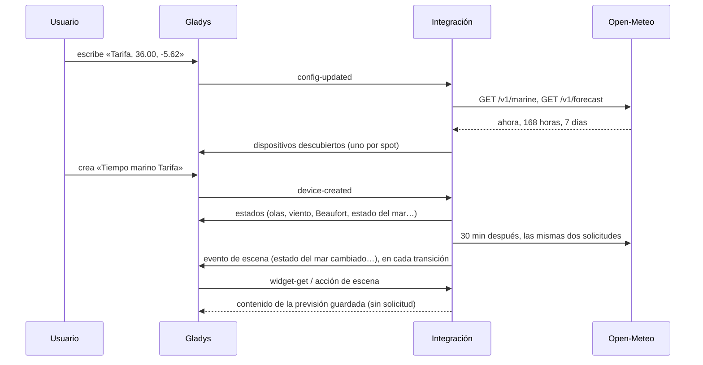
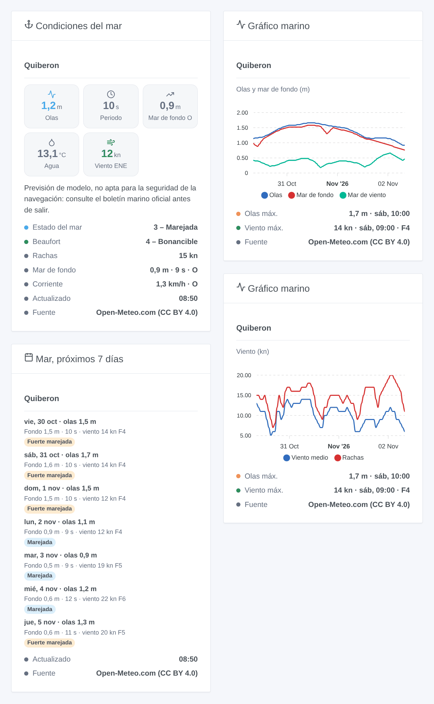

# Gladys Open-Meteo Marine

[English](README.md) · [Français](README.fr.md) · [Deutsch](README.de.md) · **Español**

[](LICENSE)
[](https://github.com/William-De71/gladys-open-meteo-marine/releases)
[](https://github.com/William-De71/gladys-open-meteo-marine/actions/workflows/release.yml)
[](https://gladysassistant.com)


Integración externa de [Gladys Assistant](https://gladysassistant.com) para el **tiempo marino de [Open-Meteo](https://open-meteo.com)** en hasta cinco spots a su elección, en cualquier lugar del mundo: olas, mar de fondo, mar de viento, temperatura del agua, corriente, nivel del mar, viento, fuerza Beaufort y estado del mar (Douglas), ahora y para siete días. Sin cuenta ni clave.

Documentación de usuario: [English](docs/en.md) · [Français](docs/fr.md) · [Deutsch](docs/de.md) · [Español](docs/es.md).

> Integración comunitaria, no afiliada a Open-Meteo. [Datos meteorológicos de Open-Meteo.com](https://open-meteo.com/), bajo [CC BY 4.0](https://creativecommons.org/licenses/by/4.0/). **Son previsiones de modelo, no aptas para la seguridad de la navegación**: antes de salir, consulte el boletín marino oficial (AEMET).

## Funcionalidades

- **Un dispositivo por spot**, hasta cinco, cada uno escrito como un nombre y «latitud, longitud» en el mar.
- **15 funcionalidades por spot**: altura significativa, periodo y dirección de las olas; altura, periodo y dirección del mar de fondo; altura del mar de viento; temperatura del agua; corriente; nivel del mar (marea incluida); viento medio, rachas y dirección del viento; **fuerza Beaufort** y **estado del mar (Douglas)**, calculados por la integración.
- **3 activadores de escena**, **1 acción de escena** y **3 widgets** (abajo).
- Viento en **nudos**, km/h o m/s en los widgets y los textos de escenas.
- Lectura cada 15 o 30 minutos, dos solicitudes por spot; las previsiones se conservan entre reinicios.
- Un punto en tierra (sin datos marinos) se rechaza con un mensaje claro.
- Cuatro idiomas en todas partes: inglés, francés, alemán, español.

## Funcionamiento




Para cada spot, la integración consulta la [Marine Weather API](https://open-meteo.com/en/docs/marine-weather-api) (olas, mar de fondo, temperatura de la superficie, corriente, nivel del mar) y la [Forecast API](https://open-meteo.com/en/docs) (viento a 10 m: la API marina no lo da). Cada respuesta contiene las condiciones actuales (datos de modelo cada 15 minutos), 168 horas y 7 días. Open-Meteo toma la celda marina más cercana de los modelos de oleaje (5 a 25 km): un punto escrito en la playa recibe olas igualmente; un punto tierra adentro no recibe nada y se rechaza. La clave del dispositivo viene de las coordenadas redondeadas a dos decimales (alrededor de 1 km): cambiar el nombre de un spot conserva su dispositivo.



### Transporte

Solo nube (`"transports": ["cloud"]`): el catálogo muestra la insignia nube. Las coordenadas de los spots se envían a Open-Meteo por Internet; nada más sobre su casa. No existe alternativa local, así que no hay botón «Preferir la conexión local».

## Dispositivos y funcionalidades

| Funcionalidad                                | Categoría / tipo               | Unidad, límites                   |
| -------------------------------------------- | ------------------------------ | --------------------------------- |
| Altura de olas, mar de fondo y mar de viento | `distance-sensor` / `decimal`  | m, 0 … 30                         |
| Periodo de olas y mar de fondo               | `duration` / `decimal`         | s, 0 … 30                         |
| Dirección de olas, mar de fondo y viento     | `angle-sensor` / `integer`     | grados, 0 … 360 (de dónde vienen) |
| Temperatura del agua                         | `temperature-sensor` / `probe` | °C, -5 … 40                       |
| Velocidad de la corriente                    | `speed-sensor` / `decimal`     | km/h, 0 … 30                      |
| Nivel del mar (sobre el nivel medio)         | `level-sensor` / `decimal`     | m, -10 … 10, marea incluida       |
| Viento medio, rachas                         | `speed-sensor` / `decimal`     | km/h, 0 … 400                     |
| Fuerza Beaufort                              | `speed-sensor` / `integer`     | 0 … 12, sin unidad                |
| Estado del mar (Douglas)                     | `level-sensor` / `decimal`     | 0 … 9, sin unidad                 |

Los dispositivos están en km/h porque Gladys no tiene unidad en nudos; los widgets y los textos de escenas siguen la **unidad del viento** de la configuración. La temperatura del agua usa el tipo `probe` para que el mar nunca entre en la temperatura de una habitación. Los valores son los de la última lectura mientras tenga menos de una hora, después la previsión horaria de la hora en curso; un valor que Open-Meteo no da (corriente o nivel del mar en algunos mares) no se publica.

Estado del mar (Douglas) según la altura significativa de las olas: 0 calma 0 m, 1 rizada ≤ 0,1 m, 2 marejadilla ≤ 0,5 m, 3 marejada ≤ 1,25 m, 4 fuerte marejada ≤ 2,5 m, 5 gruesa ≤ 4 m, 6 muy gruesa ≤ 6 m, 7 arbolada ≤ 9 m, 8 montañosa ≤ 14 m, 9 enorme. Fuerza Beaufort según el viento medio en nudos (límites de la OMM).

## Activadores, acciones de escena y widgets



**Activadores de escena** (un evento por transición; la primera lectura de un spot sirve de referencia; un valor a menos del 5 % de un umbral conserva su nivel, así que el ruido del modelo no dispara nada):

- **Estado del mar cambiado**: el estado del mar (Douglas) de un spot cambia. Filtros: spot, nuevo estado. Variables: estado y su nombre, anterior, en aumento, altura, periodo y dirección de las olas, mar de fondo, resumen.
- **Fuerza Beaufort cambiada**: la fuerza del viento medio cambia. Filtros: spot, nueva fuerza. Variables: fuerza y su nombre, anterior, en aumento, viento en km/h y nudos, rachas, dirección, resumen.
- **Viento fuerte previsto**: las próximas 24 horas alcanzan fuerza 7 (frescachón) o más, umbral de los avisos costeros, o una fuerza mayor que la ya anunciada. Filtros: spot, fuerza máxima. Variables: fuerza, viento, rachas, hora de inicio, horas hasta entonces, resumen.

**Acción de escena**: **leer el tiempo marino** de un spot, ahora o hasta 168 horas después: olas, mar de fondo, mar de viento, agua, viento (km/h y nudos), rachas, fuerza Beaufort, estado del mar y un resumen listo para usar (19 salidas). Sin solicitud a Open-Meteo: lee la previsión guardada.

**Widgets**: **Condiciones del mar** (mosaicos de olas, periodo, mar de fondo, agua y viento; estado del mar, Beaufort, rachas, mar de fondo, corriente; el aviso de navegación), **Gráfico marino** (48 o 72 horas de olas, mar de fondo y mar de viento, o de viento y rachas) y **Mar, próximos 7 días** (olas máximas, mar de fondo y periodo, viento máximo, el estado del mar como insignia). Cada uno cita su fuente.

Ejemplos:

- Cuando el **estado del mar llega a «gruesa» o más** en el puerto → enviar `{{triggerEvent.data.summary}}` al patrón.
- Cuando se **prevé viento fuerte** → avisar y recoger los muebles del jardín.
- Cada sábado a las 7:00 → **leer el tiempo marino** dentro de 3 horas y enviar el resumen si el mar de fondo supera 1 m con un periodo de más de 10 s.

## Requisitos

- Gladys Assistant **5.3.0** o posterior (palabras clave del catálogo de Gladys 5.3, widgets y escenas de las integraciones externas). Las instancias más antiguas no pueden instalar la integración.
- Acceso a Internet desde Gladys.
- Un uso no comercial: la API gratuita de Open-Meteo permite menos de 10 000 llamadas al día; cinco spots leídos cada 15 minutos quedan muy por debajo.

## Instalación

- **Desde la tienda** de Gladys (Integraciones → Integraciones externas), con un clic, una vez indexada.
- **Desde la URL del repositorio**: `https://github.com/William-De71/gladys-open-meteo-marine`.
- **Modo desarrollador**: construya la imagen en local (`docker build -t gladys-open-meteo-marine .`) e instálela desde Gladys.

## Configuración

| Campo                         | Descripción                                                                             |
| ----------------------------- | --------------------------------------------------------------------------------------- |
| Spot 1 … 5: nombre            | Se muestra en el dispositivo y los widgets. Opcional (por defecto: «Spot n»).           |
| Spot 1 … 5: latitud, longitud | Grados decimales, en el mar, a unos km de la costa: `36.00, -5.62`. Spot 1 obligatorio. |
| Intervalo de lectura          | 15 o 30 minutos (30 por defecto).                                                       |
| Unidad del viento             | Nudos (por defecto), km/h o m/s, para los widgets y los textos de escenas.              |
| Idioma de los textos          | Nombres de dispositivos y resúmenes de escenas (automático: su panel).                  |

Botones: **Leer ahora** (vuelve a consultar también un spot rechazado por estar en tierra; no de nuevo en cinco minutos si los datos son recientes) y **Diagnóstico** (escribe el estado de la integración en la pestaña Registros).

## Uso

1. Escriba de uno a cinco spots (clic derecho sobre el mar en Google Maps u OpenStreetMap para obtener las coordenadas) y guarde.
2. En la pestaña **Descubrir**, cree el dispositivo «Tiempo marino …» de cada spot.
3. Añada los widgets a un panel y construya escenas con los activadores y la acción de arriba.

## Desarrollo

```bash
npm install
npm test                       # node --test, nunca toca la red
npm run lint && npm run format:check
npx github:GladysAssistant/integration-store . --skip-image-check
scripts/build-cover.sh         # cover.jpg desde docs/assets/cover.svg
docs/illustrations/render.sh   # docs/assets/widgets.<lang>.png
node .github/scripts/release.mjs next
```

En local, el SDK lee `GLADYS_HOST_API_URL`, `GLADYS_INTEGRATION_TOKEN` y `GLADYS_INTEGRATION_SELECTOR`. `DEBUG=gladys-integration-sdk` muestra los registros del SDK y comprueba cada contenido de widget. Las pruebas leen respuestas reales de Open-Meteo grabadas en `test/fixtures/` (frente a Quiberon, frente a Marsella y Lyon tierra adentro). Las reglas del proyecto están en [CLAUDE.md](CLAUDE.md).

## Proceso de release


Cada fusión en `main` lanza la CI y luego calcula la versión a partir de los [Conventional Commits](https://www.conventionalcommits.org/) desde la última etiqueta: `feat` → menor, `fix` / `perf` → parche, `!` o `BREAKING CHANGE` → mayor (una menor por debajo de 1.0.0). `docs`, `chore`, `ci`, `test`, `style`, `refactor` y `build` solos no publican nada. El workflow genera entonces la sección del changelog, empuja la etiqueta y construye la imagen multiarquitectura. Solo después, `main` recibe el commit de release y se crea la GitHub Release. Un último job comprueba la imagen pública, el validador de la tienda y el topic.

- El título de la pull request se convierte en el commit squash y luego en la línea del changelog: escríbalo en inglés, para el usuario (`pr-title.yml` lo comprueba). No edite nunca `CHANGELOG.md` a mano.
- La 1.0.0 es una decisión: Actions → Release → Run workflow con `release-as: 1.0.0`. `dry-run` muestra la versión y las notas sin publicar nada.
- **Rama protegida**: la release empuja su commit a `main` con `GITHUB_TOKEN`. Con un ruleset en `main` más estricto que «ni borrado ni force push», añada GitHub Actions a su lista de omisión (o empuje mediante una GitHub App). Si no, el job de publicación falla con instrucciones.
- Tras la primera release, haga público el paquete `ghcr.io` (Package settings → Change visibility); si no, Gladys no puede descargarlo.

## Solución de problemas

Vea [docs/es.md](docs/es.md#solución-de-problemas). Informe de los problemas con las versiones de Gladys y de la integración, los spots y las líneas del botón **Diagnóstico**.

## Contribuir

Las issues y pull requests son bienvenidas. Ejecute `npm run format:check && npm run lint && npm test` antes de abrir una pull request y mantenga sin cambios todos los external_id y claves guardadas (vea [CLAUDE.md](CLAUDE.md)). Si cambia una respuesta de Open-Meteo, grábela en `test/fixtures/` antes de corregir la lectura.

## Seguridad

Vea [SECURITY.md](SECURITY.md): informe de las vulnerabilidades en privado. La integración no tiene ningún secreto que guardar. Solo envía las coordenadas de los spots a Open-Meteo, con un user agent que nombra el proyecto.

## Capturas por venir

Las imágenes de arriba son ilustraciones, no capturas de pantalla. Las capturas reales irán en `docs/assets/screenshots/` (PNG, 1280 × 800): `configuration.png`, `discovery.png`, `device.png`, `scene.png`.

## Licencia

[Licencia Apache 2.0](LICENSE) — vea también [NOTICE](NOTICE). [Datos meteorológicos de Open-Meteo.com](https://open-meteo.com/), bajo [CC BY 4.0](https://creativecommons.org/licenses/by/4.0/), procedentes de los modelos de los servicios meteorológicos nacionales; los widgets citan su fuente. Gracias a la documentación y al SDK de Gladys, y a Open-Meteo por su API gratuita.
