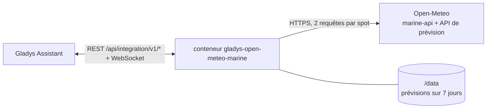
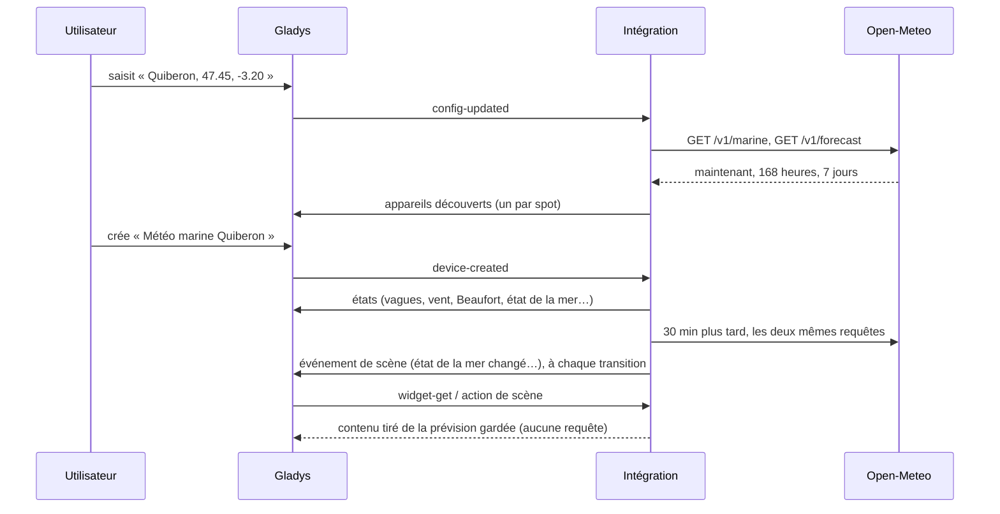
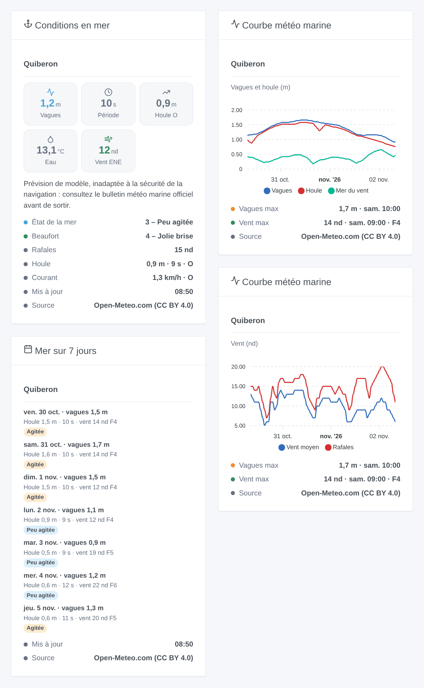

# Gladys Open-Meteo Marine

[English](README.md) · **Français** · [Deutsch](README.de.md) · [Español](README.es.md)

[](LICENSE)
[](https://github.com/William-De71/gladys-open-meteo-marine/releases)
[](https://github.com/William-De71/gladys-open-meteo-marine/actions/workflows/release.yml)
[](https://gladysassistant.com)


Intégration externe [Gladys Assistant](https://gladysassistant.com) pour la **météo marine d’[Open-Meteo](https://open-meteo.com)** sur cinq spots au plus, n’importe où dans le monde : vagues, houle, mer du vent, température de l’eau, courant, niveau de la mer, vent, force Beaufort et état de la mer (Douglas), maintenant et sur sept jours. Sans compte ni clé.

Documentation utilisateur : [English](docs/en.md) · [Français](docs/fr.md) · [Deutsch](docs/de.md) · [Español](docs/es.md).

> Intégration communautaire, non affiliée à Open-Meteo. [Données météo par Open-Meteo.com](https://open-meteo.com/), sous licence [CC BY 4.0](https://creativecommons.org/licenses/by/4.0/). **Ce sont des prévisions de modèle, inadaptées à la sécurité de la navigation** : avant de sortir, consultez le bulletin météo marine officiel (Météo-France).

## Fonctionnalités

- **Un appareil par spot**, jusqu’à cinq, chacun saisi comme un nom et « latitude, longitude » en mer.
- **15 fonctionnalités par spot** : hauteur significative, période et direction des vagues ; hauteur, période et direction de la houle ; hauteur de la mer du vent ; température de l’eau ; courant ; niveau de la mer (marée comprise) ; vent moyen, rafales et direction du vent ; **force Beaufort** et **état de la mer (Douglas)**, calculés par l’intégration.
- **3 déclencheurs de scène**, **1 action de scène** et **3 widgets** (ci-dessous).
- Vent en **nœuds**, km/h ou m/s dans les widgets et les textes des scènes.
- Lecture toutes les 15 ou 30 minutes, deux requêtes par spot ; les prévisions sont gardées entre deux redémarrages.
- Un point à terre (sans données marines) est refusé avec un message clair.
- Quatre langues partout : anglais, français, allemand, espagnol.

## Fonctionnement




Pour chaque spot, l’intégration interroge la [Marine Weather API](https://open-meteo.com/en/docs/marine-weather-api) (vagues, houle, température de surface, courant, niveau de la mer) et la [Forecast API](https://open-meteo.com/en/docs) (vent à 10 m : l’API marine n’en donne pas). Chaque réponse contient les conditions actuelles (données de modèle au pas de 15 minutes), 168 heures et 7 jours. Open-Meteo prend la maille en mer la plus proche des modèles de vagues (5 à 25 km) : un point saisi sur la plage reçoit quand même des vagues ; un point à l’intérieur des terres ne reçoit rien et il est refusé. La clé de l’appareil vient des coordonnées arrondies à deux décimales (environ 1 km) : renommer un spot garde son appareil.



### Transport

Cloud uniquement (`"transports": ["cloud"]`) : le catalogue affiche le badge cloud. Les coordonnées des spots sont envoyées à Open-Meteo par Internet ; rien d’autre sur votre maison. Il n’existe pas d’alternative locale, donc pas de bouton « Préférer la connexion locale ».

## Appareils et fonctionnalités

| Fonctionnalité                               | Catégorie / type               | Unité, bornes                       |
| -------------------------------------------- | ------------------------------ | ----------------------------------- |
| Hauteur des vagues, de la houle, mer du vent | `distance-sensor` / `decimal`  | m, 0 … 30                           |
| Période des vagues et de la houle            | `duration` / `decimal`         | s, 0 … 30                           |
| Direction des vagues, houle, vent            | `angle-sensor` / `integer`     | degrés, 0 … 360 (d’où ils viennent) |
| Température de l’eau                         | `temperature-sensor` / `probe` | °C, -5 … 40                         |
| Vitesse du courant                           | `speed-sensor` / `decimal`     | km/h, 0 … 30                        |
| Niveau de la mer (au-dessus du niveau moyen) | `level-sensor` / `decimal`     | m, -10 … 10, marée comprise         |
| Vent moyen, rafales                          | `speed-sensor` / `decimal`     | km/h, 0 … 400                       |
| Force Beaufort                               | `speed-sensor` / `integer`     | 0 … 12, sans unité                  |
| État de la mer (Douglas)                     | `level-sensor` / `decimal`     | 0 … 9, sans unité                   |

Les appareils sont en km/h car Gladys n’a pas d’unité en nœuds ; les widgets et les textes des scènes suivent l’**unité du vent** de la configuration. La température de l’eau utilise le type `probe` pour que la mer n’entre jamais dans la température d’une pièce. Les valeurs sont celles de la dernière lecture tant qu’elle a moins d’une heure, puis la prévision horaire de l’heure en cours ; une valeur qu’Open-Meteo ne donne pas (courant ou niveau de la mer dans certaines mers) n’est pas publiée.

État de la mer (Douglas), d’après la hauteur significative des vagues : 0 calme 0 m, 1 calme (ridée) ≤ 0,1 m, 2 belle ≤ 0,5 m, 3 peu agitée ≤ 1,25 m, 4 agitée ≤ 2,5 m, 5 forte ≤ 4 m, 6 très forte ≤ 6 m, 7 grosse ≤ 9 m, 8 très grosse ≤ 14 m, 9 énorme. Force Beaufort d’après le vent moyen en nœuds (bornes de l’OMM).

## Déclencheurs, actions de scène et widgets



**Déclencheurs de scène** (un événement par transition ; la première lecture d’un spot sert de référence ; une valeur à moins de 5 % d’un seuil garde son niveau, le bruit du modèle ne déclenche donc rien) :

- **État de la mer changé** : l’état de la mer (Douglas) d’un spot change. Filtres : spot, nouvel état. Variables : état et son nom, état précédent, en hausse, hauteur, période et direction des vagues, houle, résumé.
- **Force Beaufort changée** : la force du vent moyen change. Filtres : spot, nouvelle force. Variables : force et son nom, force précédente, en hausse, vent en km/h et en nœuds, rafales, direction, résumé.
- **Vent fort prévu** : les 24 prochaines heures atteignent la force 7 (grand frais) ou plus, seuil des avis de grand frais, ou une force plus haute que celle déjà annoncée. Filtres : spot, force maximale. Variables : force, vent, rafales, heure de début, heures d’ici là, résumé.

**Action de scène** : **lire la météo marine** d’un spot, maintenant ou jusqu’à 168 heures plus tard : vagues, houle, mer du vent, eau, vent (km/h et nœuds), rafales, force Beaufort, état de la mer et un résumé prêt à l’emploi (19 sorties). Aucune requête à Open-Meteo : elle lit la prévision gardée.

**Widgets** : **Conditions en mer** (tuiles vagues, période, houle, eau et vent ; état de la mer, Beaufort, rafales, houle, courant ; l’avertissement de navigation), **Courbe météo marine** (48 ou 72 heures de vagues, houle et mer du vent, ou de vent et rafales) et **Mer sur 7 jours** (vagues max, houle et période, vent max, l’état de la mer en badge). Chacun cite sa source.

Exemples :

- Quand l’**état de la mer devient « forte » ou plus** au port → envoyer `{{triggerEvent.data.summary}}` au skipper.
- Quand un **vent fort est prévu** → prévenir, et rentrer le salon de jardin.
- Chaque samedi à 7 h → **lire la météo marine** dans 3 heures et envoyer le résumé si la houle dépasse 1 m avec une période de plus de 10 s.

## Prérequis

- Gladys Assistant **5.3.0** ou plus récent (mots-clés du catalogue de Gladys 5.3, widgets et scènes des intégrations externes). Les instances plus anciennes ne peuvent pas installer l’intégration.
- Un accès à Internet depuis Gladys.
- Un usage non commercial : l’API gratuite d’Open-Meteo autorise moins de 10 000 appels par jour ; cinq spots lus toutes les 15 minutes en restent loin.

## Installation

- **Depuis le store** de Gladys (Intégrations → Intégrations externes), en un clic, une fois l’intégration indexée.
- **Depuis l’URL du dépôt** : `https://github.com/William-De71/gladys-open-meteo-marine`.
- **Mode développeur** : construisez l’image en local (`docker build -t gladys-open-meteo-marine .`) puis installez-la depuis Gladys.

## Configuration

| Champ                            | Description                                                                        |
| -------------------------------- | ---------------------------------------------------------------------------------- |
| Spot 1 … 5 : nom                 | Affiché dans l’appareil et les widgets. Facultatif (par défaut : « Spot n »).      |
| Spot 1 … 5 : latitude, longitude | Degrés décimaux, en mer, à quelques km de la côte : `47.45, -3.20`. Spot 1 requis. |
| Intervalle de lecture            | 15 ou 30 minutes (30 par défaut).                                                  |
| Unité du vent                    | Nœuds (par défaut), km/h ou m/s, pour les widgets et les textes des scènes.        |
| Langue des textes                | Noms d’appareils et résumés des scènes (automatique : votre tableau de bord).      |

Boutons : **Lire maintenant** (redemande aussi un spot refusé car à terre ; pas de nouvelle lecture dans les cinq minutes si les données sont fraîches) et **Diagnostic** (écrit l’état de l’intégration dans l’onglet Journaux).

## Utilisation

1. Saisissez un à cinq spots (clic droit sur la mer dans Google Maps ou OpenStreetMap pour obtenir les coordonnées), puis enregistrez.
2. Dans l’onglet **Découverte**, créez l’appareil « Météo marine … » de chaque spot.
3. Ajoutez les widgets à un tableau de bord, et construisez des scènes avec les déclencheurs et l’action ci-dessus.

## Développement

```bash
npm install
npm test                       # node --test, ne touche jamais le réseau
npm run lint && npm run format:check
npx github:GladysAssistant/integration-store . --skip-image-check
scripts/build-cover.sh         # cover.jpg depuis docs/assets/cover.svg
docs/illustrations/render.sh   # docs/assets/widgets.<lang>.png
node .github/scripts/release.mjs next
```

En local, le SDK lit `GLADYS_HOST_API_URL`, `GLADYS_INTEGRATION_TOKEN` et `GLADYS_INTEGRATION_SELECTOR`. `DEBUG=gladys-integration-sdk` affiche les journaux du SDK et vérifie chaque contenu de widget. Les tests lisent de vraies réponses d’Open-Meteo enregistrées dans `test/fixtures/` (au large de Quiberon, au large de Marseille, et Lyon à l’intérieur des terres). Les règles du projet sont dans [CLAUDE.md](CLAUDE.md).

## Processus de release


Chaque fusion sur `main` lance la CI, puis calcule la version à partir des [Conventional Commits](https://www.conventionalcommits.org/) depuis le dernier tag : `feat` → mineure, `fix` / `perf` → correctif, `!` ou `BREAKING CHANGE` → majeure (une mineure sous 1.0.0). `docs`, `chore`, `ci`, `test`, `style`, `refactor` et `build` seuls ne publient rien. Le workflow génère ensuite la section du changelog, pousse le tag et construit l’image multi-architecture. Ensuite seulement, `main` reçoit le commit de release et la GitHub Release est créée. Un dernier job vérifie l’image publique, le validateur du store et le topic.

- Le titre de la pull request devient le commit squash, puis la ligne du changelog : écrivez-le en anglais, pour l’utilisateur (`pr-title.yml` le vérifie). N’éditez jamais `CHANGELOG.md` à la main.
- La 1.0.0 est une décision : Actions → Release → Run workflow avec `release-as: 1.0.0`. `dry-run` affiche la version et les notes sans rien publier.
- **Branche protégée** : la release pousse son commit sur `main` avec `GITHUB_TOKEN`. Avec un ruleset sur `main` plus strict que « ni suppression ni force-push », ajoutez GitHub Actions à sa liste de contournement (ou poussez via une GitHub App). Sinon, le job de publication échoue avec des instructions.
- Après la première release, rendez public le package `ghcr.io` (Package settings → Change visibility), sinon Gladys ne peut pas le télécharger.

## Dépannage

Voir [docs/fr.md](docs/fr.md#dépannage). Signalez un problème avec les versions de Gladys et de l’intégration, les spots et les lignes du bouton **Diagnostic**.

## Contribuer

Les issues et pull requests sont bienvenues. Lancez `npm run format:check && npm run lint && npm test` avant d’ouvrir une pull request, et gardez inchangés tous les external_id et clés stockées (voir [CLAUDE.md](CLAUDE.md)). Si une réponse d’Open-Meteo change, enregistrez-la dans `test/fixtures/` avant de corriger la lecture.

## Sécurité

Voir [SECURITY.md](SECURITY.md) : signalez les vulnérabilités en privé. L’intégration n’a aucun secret à garder. Elle n’envoie que les coordonnées des spots à Open-Meteo, avec un user agent qui nomme le projet.

## Captures à venir

Les images ci-dessus sont des illustrations, pas des captures d’écran. Les vraies captures iront dans `docs/assets/screenshots/` (PNG, 1280 × 800) : `configuration.png`, `discovery.png`, `device.png`, `scene.png`.

## Licence

[Licence Apache 2.0](LICENSE) — voir aussi [NOTICE](NOTICE). [Données météo par Open-Meteo.com](https://open-meteo.com/), sous licence [CC BY 4.0](https://creativecommons.org/licenses/by/4.0/), issues des modèles des services météorologiques nationaux ; les widgets citent leur source. Merci à la documentation et au SDK de Gladys, et à Open-Meteo pour son API gratuite.
