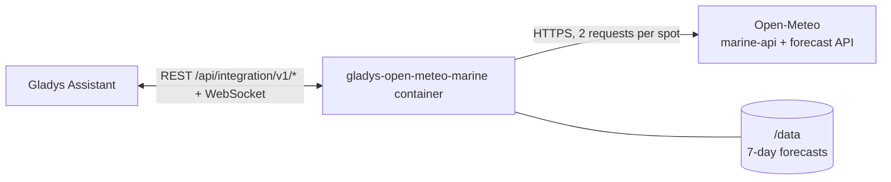
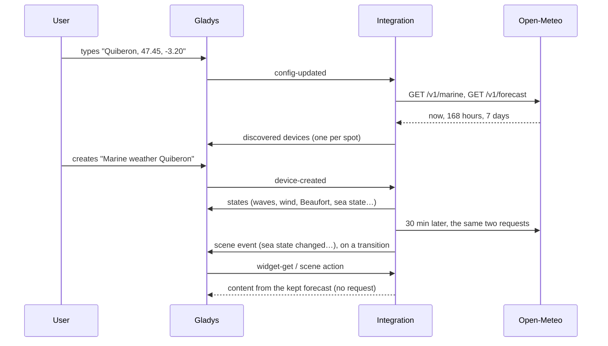
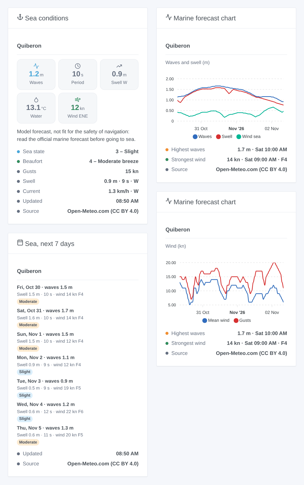

# Gladys Open-Meteo Marine

**English** · [Français](README.fr.md) · [Deutsch](README.de.md) · [Español](README.es.md)

[](LICENSE)
[](https://github.com/William-De71/gladys-open-meteo-marine/releases)
[](https://github.com/William-De71/gladys-open-meteo-marine/actions/workflows/release.yml)
[](https://gladysassistant.com)


[Gladys Assistant](https://gladysassistant.com) external integration for the **marine weather of [Open-Meteo](https://open-meteo.com)** at up to five spots of your choice, anywhere in the world: waves, swell, wind sea, water temperature, current, sea level, wind, Beaufort force and Douglas sea state, now and for seven days. No account, no key.

User documentation: [English](docs/en.md) · [Français](docs/fr.md) · [Deutsch](docs/de.md) · [Español](docs/es.md).

> Community integration, not affiliated with Open-Meteo. [Weather data by Open-Meteo.com](https://open-meteo.com/), under [CC BY 4.0](https://creativecommons.org/licenses/by/4.0/). **These are model forecasts, not fit for the safety of navigation**: before going to sea, read the official marine forecast of your weather service.

## Features

- **One device per spot**, up to five, each typed as a name and "latitude, longitude" at sea.
- **15 features per spot**: significant wave height, period and direction; swell height, period and direction; wind sea height; water temperature; ocean current; sea level (tides included); mean wind, gusts and wind direction; **Beaufort force** and **Douglas sea state**, worked out by the integration.
- **3 scene triggers**, **1 scene action** and **3 dashboard widgets** (below).
- Wind in **knots**, km/h or m/s in the widgets and scene texts.
- Read every 15 or 30 minutes, two requests per spot; the forecasts are kept across restarts.
- A point on land (no marine data) is refused with a clear message.
- Four languages everywhere: English, French, German, Spanish.

## How it works




For each spot, the integration asks the [Marine Weather API](https://open-meteo.com/en/docs/marine-weather-api) (waves, swell, sea surface temperature, current, sea level) and the [Forecast API](https://open-meteo.com/en/docs) (wind at 10 m: the marine API has none). Each answer holds the conditions now (15-minute model data), 168 hours and 7 days. Open-Meteo takes the nearest sea cell of the wave models (5 to 25 km), so a point typed on the beach still gets waves; a point inland gets nothing and is refused. The key of the device comes from the coordinates rounded to two decimals (about 1 km): renaming a spot keeps its device.



### Transport

Cloud only (`"transports": ["cloud"]`): the catalog shows the cloud badge. The coordinates of the spots are sent to Open-Meteo, over the internet; nothing else about your home. There is no local alternative, so there is no "prefer the local connection" button.

## Devices and features

| Feature                          | Category / type                | Unit, bounds                            |
| -------------------------------- | ------------------------------ | --------------------------------------- |
| Wave, swell and wind sea height  | `distance-sensor` / `decimal`  | m, 0 … 30                               |
| Wave and swell period            | `duration` / `decimal`         | s, 0 … 30                               |
| Wave, swell and wind direction   | `angle-sensor` / `integer`     | degrees, 0 … 360 (where they come from) |
| Water temperature                | `temperature-sensor` / `probe` | °C, -5 … 40                             |
| Current speed                    | `speed-sensor` / `decimal`     | km/h, 0 … 30                            |
| Sea level (above mean sea level) | `level-sensor` / `decimal`     | m, -10 … 10, tides included             |
| Mean wind, gusts                 | `speed-sensor` / `decimal`     | km/h, 0 … 400                           |
| Beaufort force                   | `speed-sensor` / `integer`     | 0 … 12, no unit                         |
| Sea state (Douglas)              | `level-sensor` / `decimal`     | 0 … 9, no unit                          |

The devices are in km/h because Gladys has no knot unit; the widgets and scene texts follow the **wind unit** of the configuration. The water temperature uses the `probe` type so that the sea never enters the temperature of a room. The values are those of the last reading while it is less than an hour old, then the hourly forecast of the current hour; a value Open-Meteo does not give (current or sea level in some seas) is not published.

Douglas sea state, from the significant wave height: 0 calm (glassy) 0 m, 1 calm (rippled) ≤ 0.1 m, 2 smooth ≤ 0.5 m, 3 slight ≤ 1.25 m, 4 moderate ≤ 2.5 m, 5 rough ≤ 4 m, 6 very rough ≤ 6 m, 7 high ≤ 9 m, 8 very high ≤ 14 m, 9 phenomenal. Beaufort force, from the mean wind in knots (WMO bounds).

## Scene triggers, actions and widgets



**Scene triggers** (one event per transition; the first reading of a spot is a reference; a value within 5 % of a bound keeps its level, so model noise fires nothing):

- **Sea state changed**: the Douglas sea state of a spot changes. Filters: spot, new sea state. Variables: sea state and its name, previous one, rising, wave height, period and direction, swell, summary.
- **Beaufort force changed**: the force of the mean wind changes. Filters: spot, new force. Variables: force and its name, previous one, rising, wind in km/h and knots, gusts, direction, summary.
- **Strong wind forecast**: the next 24 hours reach force 7 (near gale) or more, the threshold of coastal gale warnings, or a higher force than already announced. Filters: spot, highest force. Variables: force, wind, gusts, start time, hours until then, summary.

**Scene action**: **read the marine forecast** of a spot, now or in up to 168 hours: waves, swell, wind sea, water, wind (km/h and knots), gusts, Beaufort force, sea state and a ready-made summary (19 outputs). No request to Open-Meteo: it reads the kept forecast.

**Widgets**: **Sea conditions** (tiles for waves, period, swell, water and wind; sea state, Beaufort, gusts, swell, current; the navigation warning), **Marine forecast chart** (48 or 72 hours of waves, swell and wind sea, or of wind and gusts) and **Sea, next 7 days** (highest waves, swell and period, strongest wind, the sea state as a badge). Each one names its source.

Examples:

- When the **sea state becomes "rough" or more** at the harbour → send `{{triggerEvent.data.summary}}` to the skipper.
- When a **strong wind is forecast** → notify, and bring the garden furniture in.
- Every Saturday at 7:00 → **read the marine forecast** in 3 hours and send the summary if the swell is above 1 m and the period above 10 s.

## Requirements

- Gladys Assistant **5.3.0** or later (catalog keywords of Gladys 5.3, widgets and scenes of external integrations). Older instances cannot install the integration.
- Access to the internet from Gladys.
- A non-commercial use: the free API of Open-Meteo allows fewer than 10,000 calls a day; five spots read every 15 minutes stay far below.

## Installation

- **From the store** of Gladys (Integrations → External integrations), in one click, once indexed.
- **From the repository URL**: `https://github.com/William-De71/gladys-open-meteo-marine`.
- **Developer mode**: build the image locally (`docker build -t gladys-open-meteo-marine .`) and install it from Gladys.

## Configuration

| Field                           | Description                                                                       |
| ------------------------------- | --------------------------------------------------------------------------------- |
| Spot 1 … 5: name                | Shown in the device and the widgets. Optional (default: "Spot n").                |
| Spot 1 … 5: latitude, longitude | Decimal degrees, at sea, a few km off the coast: `47.45, -3.20`. Spot 1 required. |
| Reading interval                | 15 or 30 minutes (default 30).                                                    |
| Wind unit                       | Knots (default), km/h or m/s, for the widgets and scene texts.                    |
| Language of the texts           | Device names and scene summaries (automatic: your dashboard).                     |

Buttons: **Read now** (asks a spot refused as inland again; not again within five minutes when the data are fresh) and **Diagnostic** (writes the state of the integration to the Logs tab).

## Usage

1. Type one to five spots (right-click on the sea in Google Maps or OpenStreetMap to get the coordinates), then save.
2. In the **Discover** tab, create the "Marine weather …" device of each spot.
3. Add the widgets to a dashboard, and build scenes with the triggers and the action above.

## Development

```bash
npm install
npm test                       # node --test, never touches the network
npm run lint && npm run format:check
npx github:GladysAssistant/integration-store . --skip-image-check
scripts/build-cover.sh         # cover.jpg from docs/assets/cover.svg
docs/illustrations/render.sh   # docs/assets/widgets.<lang>.png
node .github/scripts/release.mjs next
```

Locally, the SDK reads `GLADYS_HOST_API_URL`, `GLADYS_INTEGRATION_TOKEN` and `GLADYS_INTEGRATION_SELECTOR`. `DEBUG=gladys-integration-sdk` shows the SDK logs and checks every widget content. The tests read real answers of Open-Meteo recorded in `test/fixtures/` (off Quiberon, off Marseille, and Lyon inland). The rules of the project are in [CLAUDE.md](CLAUDE.md).

## Release process


Every merge on `main` runs the CI, then computes the version from the [Conventional Commits](https://www.conventionalcommits.org/) since the last tag: `feat` → minor, `fix` / `perf` → patch, `!` or `BREAKING CHANGE` → major (a minor below 1.0.0). `docs`, `chore`, `ci`, `test`, `style`, `refactor` and `build` alone publish nothing. The workflow then generates the changelog section, pushes the tag and builds the multi-architecture image. After that, `main` receives the release commit and the GitHub Release is created. A last job checks the public image, the store validator and the topic.

- The pull request title becomes the squash commit, then the changelog line: write it in English, for the user (`pr-title.yml` checks it). Never edit `CHANGELOG.md` by hand.
- 1.0.0 is a decision: Actions → Release → Run workflow with `release-as: 1.0.0`. `dry-run` shows the version and the notes without publishing.
- **Protected branch**: the release pushes its commit to `main` with `GITHUB_TOKEN`. With a ruleset on `main` stricter than "no deletion, no force push", add GitHub Actions to its bypass list (or push through a GitHub App). Otherwise the publish job fails with instructions.
- After the first release, make the `ghcr.io` package public (Package settings → Change visibility), or Gladys cannot pull it.

## Troubleshooting

See [docs/en.md](docs/en.md#troubleshooting). Report issues with the versions of Gladys and of the integration, the spots, and the lines of the **Diagnostic** button.

## Contributing

Issues and pull requests are welcome. Run `npm run format:check && npm run lint && npm test` before opening a pull request, and keep every external id and stored key unchanged (see [CLAUDE.md](CLAUDE.md)). If an answer of Open-Meteo changes, record it in `test/fixtures/` before fixing the reader.

## Security

See [SECURITY.md](SECURITY.md): report vulnerabilities privately. The integration has no secret to keep. It only sends the coordinates of the spots to Open-Meteo, with a user agent naming the project.

## Screenshots to come

The images above are illustrations, not screenshots. Real screenshots will go in `docs/assets/screenshots/` (PNG, 1280 × 800): `configuration.png`, `discovery.png`, `device.png`, `scene.png`.

## License

[Apache License 2.0](LICENSE) — see also [NOTICE](NOTICE). [Weather data by Open-Meteo.com](https://open-meteo.com/), under [CC BY 4.0](https://creativecommons.org/licenses/by/4.0/), built from the models of national weather services; the widgets show their source. Thanks to the Gladys documentation and SDK, and to Open-Meteo for its free API.
